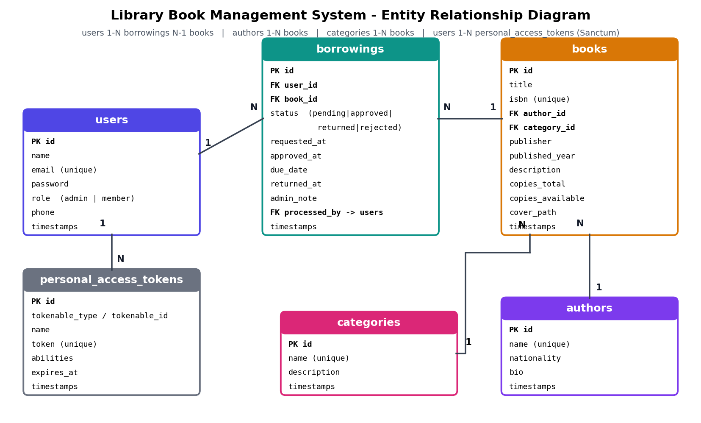

# 📚 Library Book Management System

**Developer:** [Your Full Name]  
**Course:** Course 4 – React Fundamentals with Laravel as Backend (Mini Capstone)  
**Client:** [Your Library / School Name] – a small school library

A full-stack web app where librarians manage the book catalog and members request,
borrow and return books online.

- **Frontend:** React 18 (Vite) single-page app
- **Backend:** Laravel 11 REST API with Sanctum token authentication
- **Database:** MySQL / MariaDB

---

## 1. The problem

The library tracks books in paper logbooks and spreadsheets. Nobody can quickly see which
books are available, borrow requests are verbal, overdue books are noticed late, and there
are no summary figures. This system replaces that with one online tool.

## 2. User roles

| Role | Can do |
|------|--------|
| **Admin (Kier Marvin, librarian)** | Manage books (with cover upload), members, authors and categories; approve / reject borrow requests; mark books returned; see the full dashboard with charts; view all borrowings |
| **Member** | Register / log in; browse, search and filter books; request a book; view and cancel their own pending requests; see their own dashboard |

## 3. Features (mapped to the exam requirements)

| # | Requirement | Where |
|---|-------------|-------|
| 1 | Authentication (register, login, logout, current user, Sanctum tokens, Bearer header) | `AuthController`, `AuthContext`, `services/api.js` |
| 2 | Role-based access (hidden in React **and** blocked in Laravel) | `RoleMiddleware` (`role:admin`), `BorrowingPolicy`, `AdminRoute`, `Layout` |
| 3 | Full CRUD on 2+ related resources | Books (→ author, category), Members, Authors, Categories, Borrowings (→ user, book) |
| 4 | Search and filter | Books: keyword, category, availability. Borrowings: keyword, status, overdue |
| 5 | Pagination from the API (`paginate()`) | All lists → `Pagination` component |
| 6 | Dashboard (3+ figures from the DB) | `DashboardController` + `Dashboard.jsx` (6 figures + 2 charts for admin) |
| 7 | Validation on both sides | Form Request classes + client-side checks, errors under each field |
| 8 | User feedback | Spinners, toasts, error boxes with retry, confirm dialog before delete/approve/reject |
| 9 | Status workflow | Borrowing: `pending → approved → returned` or `pending → rejected` (admin only) |

**Bonus items included:** cover image upload (Laravel Storage), local seeded book-cover thumbnails,
charts (Recharts), Laravel Feature tests.

## 4. Tech stack

React 18 · Vite · React Router 6 · Axios · Recharts · Plain responsive CSS ·
Laravel 11 · PHP 8.2+ · Laravel Sanctum · MySQL · Composer · npm · Git · Postman

## 5. Project structure

```
library-management-system/
├── backend/    Laravel API (app/, routes/api.php, database/, tests/)
├── frontend/   React SPA  (src/components, pages, services, context, hooks)
└── docs/       ERD, Postman collection, slides, screenshots, proposal, wireframes
```

## 6. Setup (fresh clone)

**Requirements:** PHP 8.2+ (with `pdo_mysql`, `mbstring`, `fileinfo`), Composer, Node 18+, MySQL/MariaDB.

### Backend

```bash
cd backend
composer install
cp .env.example .env            # Windows: copy .env.example .env
php artisan key:generate
```

Create an empty database named `library_db` (phpMyAdmin or `mysql -u root -e "CREATE DATABASE library_db"`),
check `DB_USERNAME` / `DB_PASSWORD` in `backend/.env`, then:

```bash
php artisan migrate --seed      # tables + demo data
php artisan storage:link        # makes uploaded book covers visible
php artisan serve               # API at http://localhost:8000
```

### Frontend (new terminal)

```bash
cd frontend
npm install
cp .env.example .env            # Windows: copy .env.example .env
npm run dev                     # App at http://localhost:5173
```

### Run the automated tests (optional)

```bash
cd backend
php artisan test                # uses an in-memory SQLite database (needs pdo_sqlite)
```

## 7. Demo accounts

| Role | Email | Password |
|------|-------|----------|
| Admin — Kier Marvin | `admin@library.test` | `password` |
| Member | `member@library.test` | `password` |

The seeder also creates 7 more members, 8 categories, 24 authors, 25 books and 30 borrowing
records (every status, including overdue loans). Members with borrowing history cannot be deleted,
which preserves the library's circulation records.

## 8. API documentation

Import `docs/Library_API.postman_collection.json` into Postman. Run **Login as Admin** or
**Login as Member** first; the token is stored automatically in the `{{token}}` variable.

| Method | Endpoint | Access | Purpose |
|--------|----------|--------|---------|
| POST | `/api/register` | Public | Create a member account |
| POST | `/api/login` | Public | Return a token |
| POST | `/api/logout` | Auth | Revoke the current token |
| GET | `/api/user` | Auth | Current user |
| GET | `/api/dashboard` | Auth | Summary figures (admin or member version) |
| GET | `/api/books?search=&category_id=&available=&page=&per_page=` | Auth | List, search, filter, paginate (page size capped at 50) |
| GET | `/api/books/{id}` | Auth | View one book |
| POST | `/api/books` | Admin | Create (multipart, optional `cover`) |
| PUT | `/api/books/{id}` | Admin | Update (send `POST` + `_method=PUT` when uploading a cover) |
| DELETE | `/api/books/{id}` | Admin | Delete (blocked while on loan) |
| GET / POST / PUT / DELETE | `/api/authors`, `/api/categories` | Read: Auth · Write: Admin | CRUD (`?all=1` for dropdowns) |
| GET / POST / PUT / DELETE | `/api/members` | Admin | Search, paginate, and manage member accounts |
| GET | `/api/borrowings?status=&search=&overdue=&page=` | Auth | Admin: all. Member: own only |
| POST | `/api/borrowings` | Auth | Request a book (`book_id`) → status `pending` |
| GET | `/api/borrowings/{id}` | Owner / Admin | View one |
| PATCH | `/api/borrowings/{id}/status` | Admin | `approved`, `rejected` or `returned` |
| DELETE | `/api/borrowings/{id}` | Owner (pending) / Admin | Cancel / delete |

Status codes used: `200`, `201`, `204`, `401` (no/invalid token), `403` (wrong role), `404`, `422` (validation).

**Business rules:** a member may have at most 3 open requests/loans; the same book cannot be
requested twice; approving takes one copy, returning gives it back; a book or author that is
still in use cannot be deleted.

## 9. Database (ERD)



## 10. Screenshots

See `docs/screenshots/` (login, dashboard, books, borrowings, admin forms, mobile view).

## 11. Demo video

[Add your 5–8 minute video link here]

## 12. Known limitations / Phase 2

- No email reminders for due dates, fines, or reservations
- Members cannot edit their profile
- Not deployed online yet

## 13. References

- Laravel 11 and Sanctum documentation – https://laravel.com/docs
- React, React Router, Axios and Recharts documentation
- **AI assistance:** the initial project code was generated with an AI assistant (Claude, by Anthropic),
  then reviewed, run and adapted by the developer. No downloaded template or existing system was used.
- Laravel Breeze was **not** used; authentication is written by hand with Sanctum.
